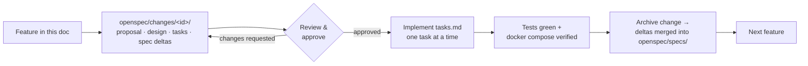

# URL Shortener Platform
## Feature Breakdown & Delivery Roadmap

**Document Version:** 1.0  
**Status:** Draft – Pending Approval  
**Source Documents:** [requirements-v1.md](../requirements/requirements-v1.md), [hld-v1.md](../hld/hld-v1.md), [lld-v1.md](../lld/lld-v1.md)  
**Spec Workflow:** OpenSpec (`openspec/`). Each feature below becomes **one OpenSpec change**, built and archived one at a time.

---

## 1. How Features Flow Through OpenSpec

Rules:
1. **One active change at a time.** The next change is proposed only after the current one is archived.
2. **Specs before code.** No implementation starts until the change's proposal and spec deltas are approved.
3. **Every change runs in Docker Compose.** A change is done only when its behaviour is verified against the local stack (`make up` + tests), not just unit tests.
4. **Each change is a vertical slice.** It ships API + data + tests + Compose wiring for one behaviour, so the system works end to end after every change.

---

## 2. Capabilities (living specs in `openspec/specs/`)

| Capability | Covers | Introduced by |
|---|---|---|
| `service-health` | Health probes, local stack startup, edge routing, scaling, graceful shutdown | F-01 |
| `api-conventions` | Error format, request IDs, structured logging, JSON handling | F-01 |
| `user-auth` | Registration, login, JWT, roles, admin bootstrap | F-02 |
| `url-shortening` | Create short URL, URL validation, short-code generation, idempotency | F-03 |
| `url-redirect` | `GET /{code}` → 302 / 404 / 410 | F-04 |
| `custom-alias` | User-chosen aliases, reserved words | F-05 |
| `url-expiration` | `expiresAt`, expired-link behaviour | F-06 |
| `link-management` | List / get / delete own links, pagination, ownership | F-07 |
| `url-caching` | L1 + Redis cache, negative cache, invalidation, cache-failure fallback | F-08 |
| `rate-limiting` | Per-user token bucket, per-IP edge limits, fallback | F-09 |
| `click-analytics` | Click events, Kafka, worker, ClickHouse, analytics APIs | F-10 |
| `admin-moderation` | Disable/enable links, domain blocklist, audit log, stats | F-11 |
| `read-scaling` | PostgreSQL read replica, read routing, read-your-writes | F-12 |
| `observability` | Metrics, dashboards, alert-worthy signals | F-13 |
| `resilience-testing` | Load tests, chaos scenarios, NFR verification | F-14 |

---

## 3. Feature Roadmap

| # | OpenSpec change ID | Feature | Requirements | Depends on | Compose profile | Status |
|---|---|---|---|---|---|---|
| F-01 | `add-platform-foundation` | Service skeleton, Nginx, PostgreSQL, Flyway, health probes, error format, logging, test harness | NFR-06, AC-10, §10 (format) | — | core | **Proposed** |
| F-02 | `add-user-auth` | Register, login, JWT, `USER`/`ADMIN` roles, admin bootstrap | §4.2, §4.3, NFR-05 | F-01 | core | Planned |
| F-03 | `add-url-shortening` | `POST /api/v1/urls`, URL validation, ID blocks + Feistel + Base62, idempotency keys | FR-01, FR-02, NFR-04, AC-1, AC-2, AC-4 | F-02 | core | Planned |
| F-04 | `add-url-redirect` | `GET/HEAD /{code}`, 302 / 404 / 410, HTML vs JSON errors | FR-03, NFR-01, AC-3, AC-5 | F-03 | core | Planned |
| F-05 | `add-custom-alias` | `customAlias` on create, alias rules, reserved words | FR-05 | F-03 | core | Planned |
| F-06 | `add-url-expiration` | `expiresAt` on create, 410 `URL_EXPIRED` on redirect | FR-04, AC-6 | F-04 | core | Planned |
| F-07 | `add-link-management` | List (keyset pagination), get, soft-delete, ownership as 404 | FR-06, AC-7 | F-04 | core | Planned |
| F-08 | `add-url-caching` | L1 + Redis, write-through, negative cache, single-flight, pub/sub invalidation, circuit breaker | NFR-01, NFR-02, Phase 2 | F-07 | cache | Planned |
| F-09 | `add-rate-limiting` | Redis token bucket (create, login), Nginx per-IP limit, local fallback | FR-08 (rate limit) | F-08 | cache | Planned |
| F-10 | `add-click-analytics` | Click publisher, Kafka, analytics-worker, ClickHouse, `/analytics` + `/clicks` | FR-07, AC-8, Phase 4 | F-04 | analytics | Planned |
| F-11 | `add-admin-moderation` | Disable/enable, domain blocklist, audit log, `/admin/stats` | FR-08, §4.3 | F-08 | core | Planned |
| F-12 | `add-read-scaling` | PG streaming replica, read routing, replica-miss fallback, read-your-writes | NFR-02, NFR-03, Phase 5 | F-08 | ha | Planned |
| F-13 | `add-observability` | Prometheus metrics, exporters, Grafana dashboards | NFR-07 | F-10 | obs | Planned |
| F-14 | `add-resilience-testing` | k6 load scenarios, chaos runbook, NFR-01/02 verification report | NFR-01–03, Phase 6 | F-12, F-13 | all | Planned |

Status values: `Planned` → `Proposed` (change folder exists) → `Approved` → `In Progress` → `Done` (archived).

### 3.1 Why this order

- **F-01 → F-04** is the shortest path to a working shortener (create + redirect) on Docker Compose.
- **F-05 → F-07** finish the functional MVP (requirements §12 AC-1…AC-8 except analytics).
- **F-08 → F-09** are HLD Phase 2. Caching comes before rate limiting because both share the Redis client and circuit breaker.
- **F-10** can run any time after F-04. It is placed after caching so the redirect path's final shape is settled before click publishing is added to it.
- **F-11 → F-14** are hardening: moderation, horizontal read scaling, observability, then proving the NFRs.

### 3.2 Requirements Coverage Check

| Requirement | Feature(s) |
|---|---|
| FR-01 URL creation | F-03 |
| FR-02 Unique codes | F-03 |
| FR-03 Redirection | F-04 |
| FR-04 Expiration | F-06 |
| FR-05 Custom alias | F-05 |
| FR-06 Link management | F-07 |
| FR-07 Analytics | F-10 |
| FR-08 Abuse prevention | F-03 (URL validation), F-09 (rate limits), F-11 (blocklist, deactivation) |
| NFR-01 Performance | F-04, F-08, verified in F-14 |
| NFR-02 Availability | F-01 (scaling), F-08, F-12, verified in F-14 |
| NFR-03 Scalability | F-01, F-12, verified in F-14 |
| NFR-04 Reliability | F-03 (idempotency, uniqueness) |
| NFR-05 Security | F-02, F-03, F-07, F-11 |
| NFR-06 Maintainability | F-01 (structure, logging, tests) and every change (tests + docs) |
| NFR-07 Observability | F-01 (logs), F-13 (metrics) |
| AC-9 Automated tests | Every change |
| AC-10 Runs on Docker | F-01, then every change |

All FR/NFR items and all 10 acceptance criteria map to at least one feature.

---

## 4. Definition of Done (per change)

Taken from requirements §16, made concrete:

- [ ] `proposal.md`, `tasks.md` and spec deltas approved (`design.md` when the change has non-trivial design).
- [ ] All tasks in `tasks.md` checked.
- [ ] Unit + integration tests pass; every spec scenario has at least one automated test.
- [ ] `docker compose up` from a clean state brings the change's services up healthy, and its scenarios pass against `http://localhost:8080`.
- [ ] HLD/LLD updated if the implementation diverged.
- [ ] Logs/metrics for the new behaviour exist.
- [ ] Failure scenarios in the change's specs are tested.
- [ ] Code reviewed; change archived into `openspec/specs/`; this roadmap's status updated.
