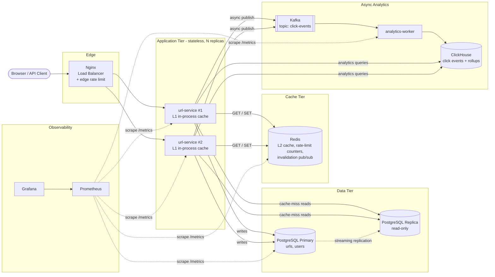
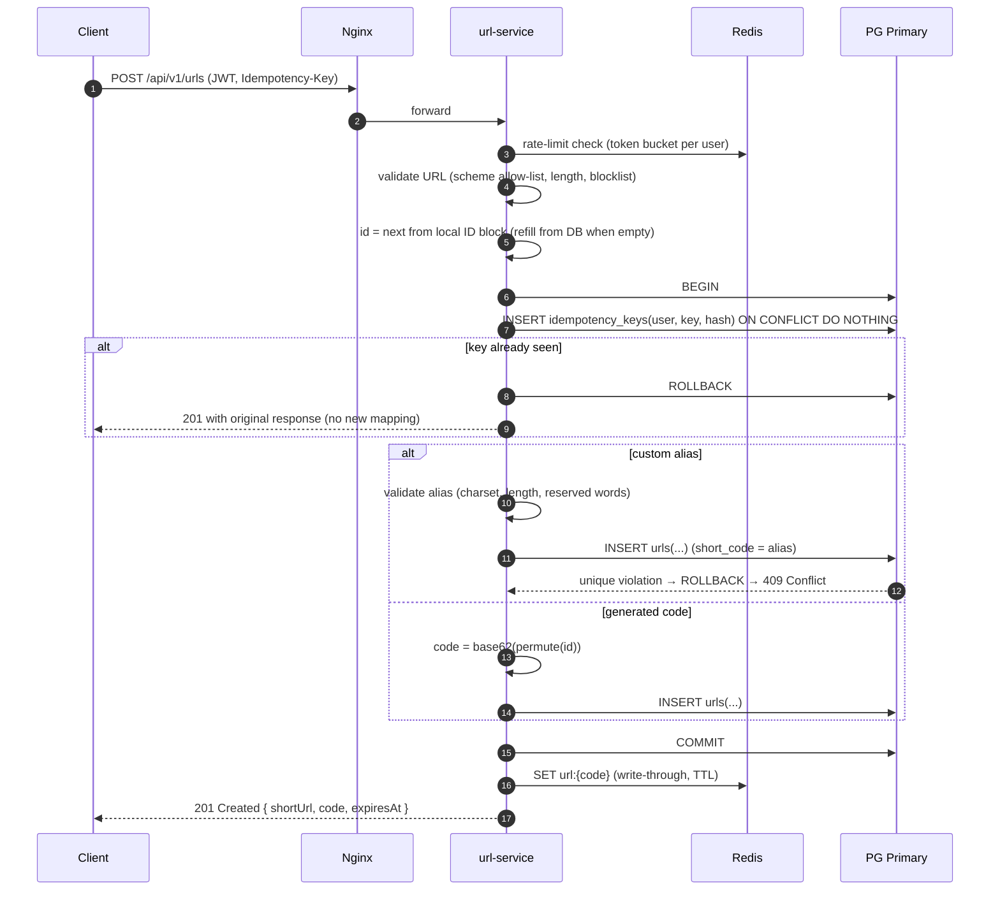
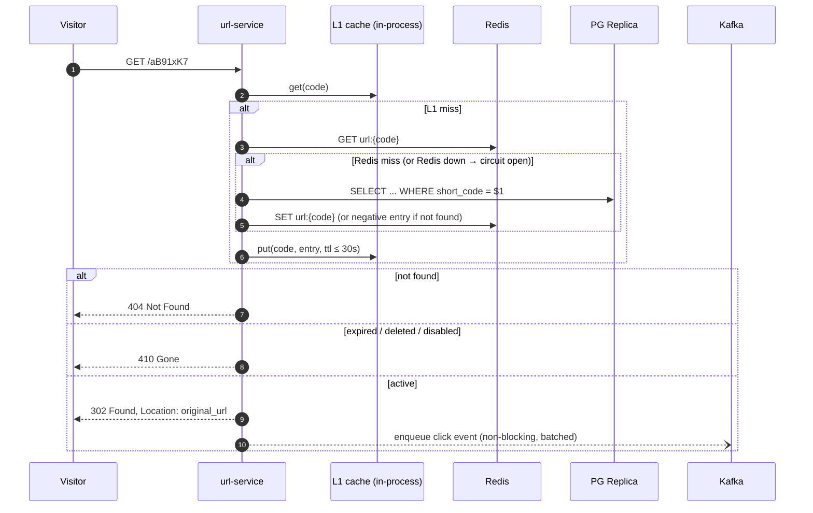
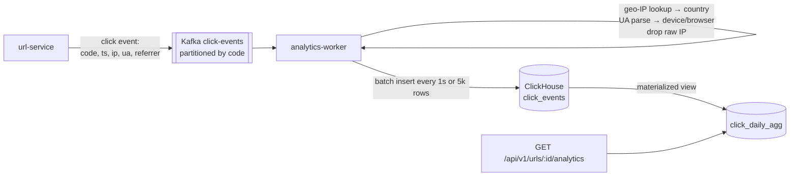
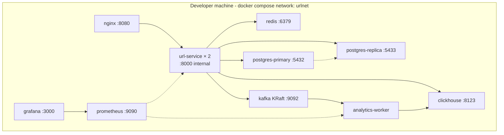

# URL Shortener Platform
## High-Level Design (HLD) Document

**Document Version:** 1.0  
**Status:** Draft – Pending Design Review  
**Document Type:** HLD / System Design  
**Source Requirements:** [requirements-v1.md](../requirements/requirements-v1.md)  
**Target Environment:** Local Docker Compose (single host), designed to map 1:1 onto a production topology later

---

## 1. Purpose and Scope

This document describes the high-level architecture of the URL Shortener Platform: its components, traffic and capacity estimates, data storage choices, caching strategy, scaling approach and failure handling.

All infrastructure runs as containers in a **local Docker Compose environment**. Each Compose service represents a component that would become an independently scaled deployment in production. Where the local setup differs from what production would need, this is called out explicitly under **Local vs Production** notes.

Out of scope for this document: API request/response schemas (API design doc), class-level design (LLD), and multi-region deployment (requirements §11).

---

## 2. Design Principles

1. **Redirect path is sacred.** The `GET /{shortCode}` path must do the minimum work: cache lookup, status check, redirect. Everything else (analytics, logging enrichment) is asynchronous.
2. **Stateless application tier.** No session or ID state lives only in an app instance, so any instance can be killed or added at any time.
3. **Read-optimised.** The workload is ~100:1 read-to-write; caching and read replicas carry most of the load.
4. **Graceful degradation.** Cache, analytics or replica failure must degrade performance, not correctness.
5. **Never reuse a short code.** Once issued, a code is permanently bound to its mapping, even after deletion or expiry.
6. **Production-shaped locally.** Every component in Compose has a real production counterpart; nothing is a toy that must be thrown away later.

---

## 3. Resolved Design Decisions (Requirements §14 Open Questions)

These are **proposed** answers to the open questions in the requirements document, to be confirmed in design review.

| # | Question | Proposed decision | Rationale |
|---|---|---|---|
| 1 | Should URL creation require authentication? | **Yes** for the MVP. | Simplifies abuse prevention (FR-08), enables link ownership (FR-06). |
| 2 | Allow anonymous URL creation? | **No** in MVP; may be added later behind strict rate limits and a short default expiry. | Anonymous creation is the largest abuse vector. |
| 3 | Random IDs or Base62 encoding? | **Base62 encoding of a unique numeric ID**, obfuscated with a reversible permutation so codes are not sequential. | Guaranteed uniqueness without collision retries; non-guessable output. See §8. |
| 4 | Custom aliases in MVP? | **Yes**, for registered users only. | Low cost: same table, unique constraint handles conflicts. |
| 5 | Physically delete expired URLs? | **No.** Soft-delete/expire; a background job archives rows older than a retention window. Codes are never reused. | Distinguishes expired (410) from unknown (404); avoids a recycled code pointing somewhere new. |
| 6 | Analytics sync or async? | **Asynchronous** via a message broker. | Requirement FR-07: analytics must not add redirect latency. |
| 7 | HTTP 301 or 302? | **302 (Found)** by default. | 301 is cached by browsers indefinitely, which breaks click counting, deletion, expiry and admin deactivation. |
| 8 | Deleted URLs immediately inaccessible? | **Yes**, within the L1 cache TTL (≤ 30 s), enforced by explicit cache invalidation. | See §9.4. |
| 9 | Behaviour when cache is unavailable? | **Fail open to the database** through a circuit breaker, with read replicas absorbing load; rate limiting falls back to a per-instance in-memory limiter. | Redirects keep working with higher latency. |
| 10 | Multiple regions? | **No** for MVP (out of scope per §11). Design keeps regions possible: stateless app, globally unique IDs. | — |

---

## 4. Traffic and Capacity Estimation

Based on requirements §7 (hypothetical assumptions).

### 4.1 Request Rates

| Metric | Calculation | Result |
|---|---|---:|
| URL creations (avg) | 1,000,000 / 86,400 s | **~12 writes/s** |
| URL creations (peak, 10×) | 12 × 10 | **~120 writes/s** |
| Redirects (avg) | 100,000,000 / 86,400 s | **~1,157 reads/s** |
| Redirects (peak) | given | **10,000 reads/s** |
| Read : write ratio | 100M : 1M | **100 : 1** |
| Click events into analytics (peak) | = peak redirects | **~10,000 events/s** |

### 4.2 Storage — URL Mappings

| Metric | Calculation | Result |
|---|---|---:|
| URLs over 5 years | 1M × 365 × 5 | **~1.83 billion rows** |
| Row size | ~500 B URL + ~100 B metadata | ~600 B |
| Raw data | 1.83B × 600 B | **~1.1 TB** |
| With indexes and overhead (~1.5×) | | **~1.6 TB** |

### 4.3 Storage — Analytics

| Metric | Calculation | Result |
|---|---|---:|
| Click event size | timestamp, code, referrer, country, device, ~150 B | ~150 B |
| Raw events per day | 100M × 150 B | **~15 GB/day** |
| Raw events per year | 15 GB × 365 | **~5.5 TB/year** |

Raw click events therefore cannot be kept forever in the primary store. Policy: **raw events kept 90 days (~1.4 TB), then rolled up** into daily per-link aggregates (tiny by comparison) which are kept for the life of the link.

### 4.4 Short Code Length

| Length | Base62 keyspace | Years of headroom at 1M/day |
|---:|---:|---:|
| 6 | 62⁶ ≈ 56.8 billion | ~155 years |
| **7** | 62⁷ ≈ 3.5 trillion | ~9,600 years |

**Decision: 7 characters.** 6 would suffice for volume, but 7 makes the obfuscated keyspace sparse, so guessing a valid code at random is very unlikely.

### 4.5 Cache Sizing

- Assume 80/20: 20% of links accessed per day produce 80% of the traffic.
- Production: cache ~10M hot entries × ~700 B (key + value + Redis overhead) ≈ **~7 GB** of Redis memory.
- Local: Redis capped at **256 MB** with `allkeys-lru`, which holds ~350k entries — enough to demonstrate hit-ratio behaviour in load tests.

### 4.6 Bandwidth

- Redirect egress at peak: 10,000 × ~600 B (302 response with `Location` header) ≈ **~6 MB/s**.
- Creation ingress at peak: 120 × ~1 KB ≈ **~120 KB/s**.

### 4.7 Local vs Production

A single laptop running Compose will not sustain 10,000 RPS end-to-end with every component co-located. Local load tests (k6) target relative behaviour — cache hit ratio, p99 under cache failure, scaling from 2 to 4 app replicas — rather than absolute production numbers.

---

## 5. Architecture Overview

### 5.1 Component Diagram



### 5.2 Components

| Component | Responsibility | Scales by |
|---|---|---|
| **Nginx (LB)** | TLS termination (prod), round-robin load balancing, coarse per-IP rate limiting, health-check routing. | Horizontal behind DNS / cloud LB in prod. |
| **url-service** | Single deployable with two logical paths: **redirect** (hot, read) and **management API** (create, list, delete, analytics, admin). Holds an L1 in-process LRU cache. | Horizontal replicas (`docker compose up --scale url-service=N`). |
| **Redis** | L2 shared cache for code → URL; distributed rate-limit counters; pub/sub channel for cache invalidation. | Redis Cluster / replicas in prod. |
| **PostgreSQL primary** | System of record for URLs, users, ID blocks, idempotency keys. All writes. | Vertical first, then hash partitioning / sharding by code. |
| **PostgreSQL replica** | Serves cache-miss redirect lookups and list queries. | Add replicas. |
| **Kafka** | Durable buffer for click events, decoupling redirects from analytics writes. | Partitions + brokers. |
| **analytics-worker** | Consumes click events, enriches (geo-IP, user-agent parsing), batch-inserts into ClickHouse. | Consumer group, one consumer per partition. |
| **ClickHouse** | Columnar store for click events and materialised daily rollups; serves analytics queries. | Shards + replicas in prod. |
| **Prometheus / Grafana** | Metrics collection and dashboards for NFR-07. | — |

**Why one service rather than separate redirect and write services?** At this scale, splitting adds deployment complexity without benefit. The code is structured as separate modules with separate thread pools / connection pools, so the redirect path can be extracted into its own service (Phase 5+) if write traffic ever interferes with redirect latency.

---

## 6. Core Flows

### 6.1 Create Short URL (FR-01, FR-02, FR-05)



### 6.2 Redirect (FR-03, FR-04)



The click event is put on an **in-memory bounded queue** and flushed to Kafka in batches by a background producer. If the queue is full (Kafka down for a long time), events are dropped and counted in a metric. Analytics is best-effort; redirects are not.

### 6.3 Analytics Pipeline (FR-07)



- **Privacy (NFR-05):** the raw IP is used only for geo lookup in the worker and is **never stored**. Only country/region is persisted.
- **Delivery semantics:** at-least-once. The worker commits Kafka offsets after the ClickHouse insert succeeds; occasional duplicates are acceptable for approximate analytics (ClickHouse `ReplacingMergeTree` on an event ID can remove them if exact counts are needed later).

### 6.4 Delete / Admin Disable (FR-06, FR-08)

1. `DELETE /api/v1/urls/{id}` → verify ownership → `UPDATE urls SET status='DELETED', deleted_at=now()` on the primary.
2. `DEL url:{code}` in Redis.
3. `PUBLISH cache-invalidate {code}` → every url-service instance evicts the code from its L1 cache.
4. If a pub/sub message is missed, the L1 TTL (≤ 30 s) puts an upper bound on staleness.

---

## 7. Database Design

### 7.1 Choice: PostgreSQL

| Option | Pros | Cons | Verdict |
|---|---|---|---|
| **PostgreSQL** | ACID; unique constraints make alias/code uniqueness trivial; relational ownership (users ↔ urls); streaming replicas; partitioning; mature tooling; easy in Compose. | Single-writer; sharding at billions of rows needs work (Citus or app-level). | **Chosen** |
| Cassandra / ScyllaDB | Linear write scaling, built for key-value lookups at huge scale. | No ad-hoc queries, no cross-row uniqueness (custom aliases need LWT), heavy to run locally. | Revisit if writes exceed ~10k/s. |
| DynamoDB / MongoDB | Managed KV/document; good fit for code → URL lookup. | Ties to a cloud vendor (DynamoDB); unnecessary at ~120 writes/s peak. | Not needed. |

At ~120 writes/s peak and ~1.8B rows over five years, a single well-indexed PostgreSQL primary with read replicas and hash partitioning is enough. The redirect read load is absorbed mainly by caches, not the database.

### 7.2 Schema (logical)

```sql
-- Users
users (
  id            BIGINT PRIMARY KEY,
  email         TEXT UNIQUE NOT NULL,
  password_hash TEXT NOT NULL,
  role          TEXT NOT NULL DEFAULT 'USER',  -- USER | ADMIN
  created_at    TIMESTAMPTZ NOT NULL DEFAULT now()
);

-- URL mappings (hash-partitioned by short_code in Phase 5+)
urls (
  id            BIGINT PRIMARY KEY,              -- from ID allocator
  short_code    VARCHAR(32) NOT NULL UNIQUE,     -- generated or custom alias
  original_url  TEXT NOT NULL,                   -- max 2048 chars enforced in app
  user_id       BIGINT NOT NULL REFERENCES users(id),
  is_custom     BOOLEAN NOT NULL DEFAULT false,
  status        TEXT NOT NULL DEFAULT 'ACTIVE',  -- ACTIVE | DELETED | DISABLED
  expires_at    TIMESTAMPTZ NULL,
  created_at    TIMESTAMPTZ NOT NULL DEFAULT now(),
  deleted_at    TIMESTAMPTZ NULL
);
CREATE INDEX idx_urls_user_created ON urls (user_id, created_at DESC);

-- ID block allocator
id_blocks (
  name          TEXT PRIMARY KEY,                -- 'url'
  next_value    BIGINT NOT NULL
);

-- Reserved aliases (api, admin, login, health, metrics, ...)
reserved_aliases ( alias TEXT PRIMARY KEY );
```

ClickHouse (analytics):

```sql
click_events (
  event_id    UUID,
  short_code  String,
  ts          DateTime,
  country     LowCardinality(String),
  referrer    String,
  device      LowCardinality(String),
  browser     LowCardinality(String)
) ENGINE = MergeTree
  PARTITION BY toYYYYMM(ts)
  ORDER BY (short_code, ts)
  TTL ts + INTERVAL 90 DAY;

click_daily_agg  -- materialized view: (short_code, day, country, device) → count
  ENGINE = SummingMergeTree ORDER BY (short_code, day, country, device);
```

### 7.3 Access Patterns

| Access | Query | Served by |
|---|---|---|
| Redirect lookup | `WHERE short_code = ?` | L1 → Redis → PG replica (unique index) |
| Create | `INSERT` | PG primary |
| List my URLs | `WHERE user_id = ? ORDER BY created_at DESC` (keyset pagination) | PG replica |
| Delete / disable | `UPDATE ... WHERE id = ?` | PG primary |
| Link analytics | `WHERE short_code = ? AND day BETWEEN ...` | ClickHouse rollup |

### 7.4 Why ClickHouse for Analytics (and not PostgreSQL)

At ~10k events/s peak and ~15 GB/day, PostgreSQL would need heavy partitioning and would compete with the system-of-record for I/O. ClickHouse is built for append-heavy, aggregate-read workloads, compresses click data roughly 10×, and has native TTLs and materialised rollups. Because url-service only publishes to Kafka, the analytics sink could be swapped later without touching url-service.

---

## 8. Short Code Generation (FR-02, NFR-04)

### 8.1 Approaches Considered

| Approach | Uniqueness | Coordination | Predictability | Verdict |
|---|---|---|---|---|
| Random 7-char + check-and-retry | Probabilistic; collisions grow with fill | DB round-trip per attempt | Unpredictable | Rejected: retries under load, check-then-insert races. |
| Hash (MD5/SHA) of URL, truncated | Collisions on truncation | DB check | Same URL → same code (may be unwanted) | Rejected. |
| Single DB sequence per insert | Guaranteed | DB hit per ID; single point | Sequential (enumerable) | Rejected as-is. |
| Snowflake-style (time + worker + seq) | Guaranteed | Worker-ID assignment | Roughly time-ordered | Produces 64-bit IDs → 11 Base62 chars; too long. |
| **Block allocation + Base62 + permutation** | **Guaranteed** | **One DB call per 1,000 IDs** | **Non-sequential** | **Chosen** |

### 8.2 Chosen Design

1. **Block allocation:** each url-service instance reserves a block of IDs atomically:
   `UPDATE id_blocks SET next_value = next_value + 1000 WHERE name='url' RETURNING next_value - 1000;`
   The instance hands out IDs from memory until the block runs out, then reserves another. If an instance crashes, the unused part of its block is simply skipped. Gaps are harmless.
2. **Permutation:** the ID is passed through a reversible bijection on `[0, 62⁷)`, for example a small Feistel network with a secret key. Consecutive IDs map to unrelated-looking values, but uniqueness is preserved because it is a bijection.
3. **Encoding:** Base62 (`0-9A-Za-z`), left-padded to 7 characters.
4. **Custom aliases** share the `short_code` column. The `UNIQUE` constraint is the final arbiter; a conflict returns `409`. Aliases are restricted to `[A-Za-z0-9-_]{4,32}`, checked against `reserved_aliases`, and must contain a `-` or `_` or be 8+ characters, which keeps them out of the 7-char generated namespace.

**Retry safety (NFR-04):** clients send an `Idempotency-Key` header. The key is inserted into a PostgreSQL `idempotency_keys` table **in the same transaction** as the URL row and kept for 24 h, so a retried request returns the same short URL instead of creating a second mapping, even if Redis is down. Details in LLD §6.6.

---

## 9. Caching Strategy

### 9.1 Two-Level Cache

| Level | Where | Size (local) | TTL | Purpose |
|---|---|---|---|---|
| **L1** | In-process LRU in each url-service replica | ~10k entries | 30 s | Absorbs **hot keys** (viral links) without a network hop; protects Redis from a single-key hotspot. |
| **L2** | Redis | 256 MB, `allkeys-lru` | 24 h (capped at `expires_at`) | Shared across replicas; main hit-ratio driver. |

Cache value: `{ originalUrl, status, expiresAt }`. The status and expiry are checked **on every hit**, so an entry cached before its expiry time still returns `410` afterwards.

### 9.2 Patterns

- **Read path:** cache-aside (L1 → L2 → DB, populate on miss).
- **Write path:** write-through on create. A freshly shared link is usually clicked immediately, so this avoids a cold miss.
- **Negative caching:** unknown codes are cached as `NOT_FOUND` for 60 s. This blocks **cache penetration** (bots scanning random codes from hitting the DB).
- **Stampede protection:** single-flight per key inside each instance (concurrent misses for the same code share one DB query), plus ±10% TTL jitter to avoid synchronised expiry.

### 9.3 Cache Failure (Requirements §14 Q9)

- Redis calls have a tight timeout (~5 ms) and sit behind a **circuit breaker**.
- When the breaker is open: L1 still serves hot keys; misses go straight to the PG replica; rate limiting falls back to a per-instance in-memory limiter (less precise, still protective).
- Cache-hit-ratio and breaker-state metrics alert on degraded mode.

### 9.4 Invalidation

Delete, disable or update → DB write → `DEL` in Redis → `PUBLISH cache-invalidate`. All replicas subscribe and evict from L1. The worst-case staleness if a message is lost is the L1 TTL of 30 s.

---

## 10. Scaling Strategy

| Layer | Local (Compose) | Production path |
|---|---|---|
| Load balancer | 1 Nginx container | Managed LB (ALB / GCLB) + CDN in front for static assets |
| url-service | 2 replicas by default; `--scale url-service=4` for scaling tests | Autoscale on CPU / RPS (HPA on Kubernetes) |
| Cache | 1 Redis | Redis Cluster (sharded) with replicas; L1 absorbs hot keys |
| PostgreSQL | 1 primary + 1 streaming replica | More replicas → hash partitioning on `short_code` → sharding (Citus or app-level via code→shard map) |
| Kafka | 1 broker (KRaft mode), 6 partitions | 3+ brokers, replication factor 3 |
| analytics-worker | 1 replica (scale up to the partition count) | Consumer group scaled to the partition count |
| ClickHouse | 1 node | Sharded + replicated cluster |

**Hot URLs:** handled by the L1 cache (each replica serves the hot key from memory), so one viral link costs about one Redis read per replica per 30 s, not one per request.

**Database growth:** URL rows are append-mostly and never reused. Beyond ~500M rows, hash-partition `urls` by `short_code`, which keeps index sizes per partition manageable and is the first step towards sharding.

---

## 11. Reliability and Failure Handling

| Failure | Impact | Mitigation | Redirects work? |
|---|---|---|---|
| One url-service replica dies | Its in-flight requests fail | Nginx health checks remove it; others serve traffic; unused ID block is discarded | ✅ |
| Redis down | Higher latency, more DB load | Circuit breaker → L1 + PG replica; local rate limiter | ✅ (slower) |
| PG replica down | Cache-miss reads fail over | Read pool falls back to the primary | ✅ |
| PG primary down | Creates/deletes fail (503) | Cached redirects unaffected; replica still serves misses. Prod: automatic failover (Patroni / managed HA) | ✅ (reads) / ❌ (writes) |
| Kafka down | Click events buffer, then drop | Bounded in-memory queue + `analytics_events_dropped_total` metric | ✅ |
| analytics-worker down | Analytics delayed | Kafka retains events; worker catches up on restart | ✅ |
| ClickHouse down | Analytics API 503; ingestion pauses | Kafka retains events; worker retries with backoff | ✅ |

### 11.1 HTTP Status Mapping (Requirements §10)

| Situation | Status |
|---|---|
| Created | 201 |
| Redirect | 302 |
| Invalid URL / alias | 400 |
| Unauthenticated | 401 |
| Not admin (admin endpoints) | 403 |
| Not owner of a link (reported as not found) | 404 |
| Unknown short code | 404 |
| Duplicate alias | 409 |
| Expired / deleted / disabled link | 410 |
| Rate limit exceeded | 429 (with `Retry-After`) |
| DB unavailable on write path | 503 |

---

## 12. Security and Abuse Prevention (FR-08, NFR-05)

- **Authentication:** JWT access tokens (short-lived) issued by the url-service auth module; `ADMIN` role for admin endpoints.
- **Authorisation:** every mutation checks `urls.user_id = token.sub` (or the admin role).
- **URL validation:** allow only `http`/`https`; max length 2048; reject `javascript:`, `data:`, `file:`; reject links pointing back at the shortener's own domain (redirect loops); reject private/loopback IP hosts.
- **Suspicious URL detection:** a domain blocklist (local file / DB table in MVP). Later: asynchronous Safe-Browsing-style check after creation that auto-disables flagged links.
- **Rate limiting:** two layers. Nginx `limit_req` per IP (coarse, protects against floods); Redis token bucket per user/API key in the app (fine-grained, e.g. 100 creates/hour).
- **Admin deactivation:** `status = DISABLED` plus cache invalidation (§9.4).
- **Analytics privacy:** no raw IPs stored; referrers stored without query strings.

---

## 13. Observability (NFR-07)

| Metric (Prometheus) | Source |
|---|---|
| `http_requests_total{route,status}` | url-service — request and error rate |
| `http_request_duration_seconds{route}` (histogram → p50/p95/p99) | url-service — redirect and create latency |
| `cache_requests_total{level,result}` | url-service — L1/L2 hit ratio |
| `db_query_duration_seconds{pool}` | url-service — DB latency |
| `urls_created_total` | url-service — creation rate |
| `circuit_breaker_state{dependency}` | url-service |
| `analytics_events_dropped_total`, Kafka consumer lag | url-service / worker |
| `up{job="url-service"}` | Prometheus — active instances |

- **Logs:** structured JSON to stdout with a request ID; `docker compose logs` locally (Loki optional).
- **Tracing (optional, Phase 6):** OpenTelemetry → Jaeger, for following a request through LB → service → Redis → DB.
- **Grafana dashboards:** Redirect SLO (latency, error rate), Cache, Database, Analytics pipeline.

---

## 14. Local Deployment Topology (Docker Compose)



| Service | Image (indicative) | Host port | Replicas | Volume | Health check |
|---|---|---|---:|---|---|
| nginx | `nginx:alpine` | 8080 | 1 | config | `GET /health` upstream |
| url-service | built from repo | — (internal) | 2 | — | `GET /health/ready` |
| redis | `redis:7-alpine` (`maxmemory 256mb`, `allkeys-lru`) | 6379 | 1 | optional | `redis-cli ping` |
| postgres-primary | `postgres:16` | 5432 | 1 | `pg-primary-data` | `pg_isready` |
| postgres-replica | `postgres:16` (streaming replica) | 5433 | 1 | `pg-replica-data` | `pg_isready` |
| kafka | `apache/kafka` (KRaft, single node) | 9092 | 1 | `kafka-data` | broker API check |
| analytics-worker | built from repo | — | 1 | — | consumer-lag metric |
| clickhouse | `clickhouse/clickhouse-server` | 8123 | 1 | `ch-data` | `GET /ping` |
| prometheus | `prom/prometheus` | 9090 | 1 | config | — |
| grafana | `grafana/grafana` | 3000 | 1 | provisioning | — |

**Compose profiles** keep the laptop footprint small during early phases:

| Profile | Services | Matches phase |
|---|---|---|
| `core` (default) | nginx, url-service, postgres-primary | MVP |
| `cache` | + redis | Phase 2 |
| `analytics` | + kafka, analytics-worker, clickhouse | Phase 4 |
| `ha` | + postgres-replica, url-service scaled to 2+ | Phase 5–6 |
| `obs` | + prometheus, grafana | Any phase |

Example: `docker compose --profile cache --profile analytics --profile obs up --scale url-service=3`

Approximate memory for the full stack: ~3–4 GB (ClickHouse and Kafka are the largest). Give Docker Desktop at least 6 GB.

---

## 15. Mapping to Evolution Phases (Requirements §15)

| Phase | HLD components introduced |
|---|---|
| MVP | nginx, url-service, PostgreSQL primary, DB-based ID blocks, idempotency keys |
| Phase 2 – Caching | Redis L2, L1 in-process cache, negative caching, invalidation pub/sub |
| Phase 3 – Distributed IDs | Block allocator + Feistel permutation hardened for many replicas |
| Phase 4 – Async analytics | Kafka, analytics-worker, ClickHouse (`analytics` profile) |
| Phase 5 – Horizontal scale | url-service replicas behind nginx, PG read replica, load tests with k6 |
| Phase 6 – HA & failure recovery | Circuit breakers, chaos tests (`docker compose stop redis` / `kill` replicas), tracing |
| Phase 7 – Multi-region | Out of scope; enabled by stateless app + globally unique ID blocks per region |

---

## 16. Requirements Traceability

| Requirement | Addressed in |
|---|---|
| FR-01 URL creation | §6.1 |
| FR-02 Unique codes | §8 |
| FR-03 Redirection | §6.2 |
| FR-04 Expiration | §6.2, §9.1 (status check on every hit), §11.1 |
| FR-05 Custom alias | §6.1, §8.2 |
| FR-06 Link management | §6.4, §7.3 |
| FR-07 Analytics | §6.3, §7.4 |
| FR-08 Abuse prevention | §12 |
| NFR-01 Performance | §9, §6.2 |
| NFR-02 Availability | §11 |
| NFR-03 Scalability | §10 |
| NFR-04 Reliability | §8.2 (idempotency), §11 |
| NFR-05 Security | §12 |
| NFR-07 Observability | §13 |

---

## 17. Risks and Trade-offs

| Decision | Trade-off accepted |
|---|---|
| 302 over 301 | Every click hits the service (more load) in exchange for accurate analytics and revocable links. |
| L1 cache with 30 s TTL | Up to 30 s of staleness after delete/disable if pub/sub misses; bounded and documented. |
| Best-effort analytics | Events may be dropped during long Kafka outages; redirects are never blocked. |
| Single PG primary | Write path unavailable during primary failover; acceptable at 99.9% target with automated failover in prod. |
| Kafka + ClickHouse locally | Heavier laptop footprint; mitigated by Compose profiles. |

---

## 18. Open Items for Design Review

1. Confirm the §3 decisions, especially no anonymous creation and 302 redirects.
2. Confirm the 90-day raw click retention.
3. ~~Choose the application language/framework~~ **Decided:** Python 3.14 + FastAPI.
4. ~~Decide whether the MVP uses the PostgreSQL click table or goes straight to Kafka + ClickHouse.~~ **Decided in LLD:** Kafka + ClickHouse from the start, behind the `analytics` Compose profile.

---

**End of Document**

**Next Deliverable:** Low-Level Design — see [lld-v1.md](../lld/lld-v1.md).
